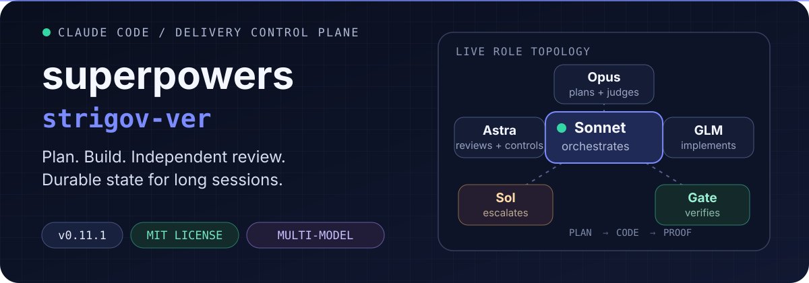
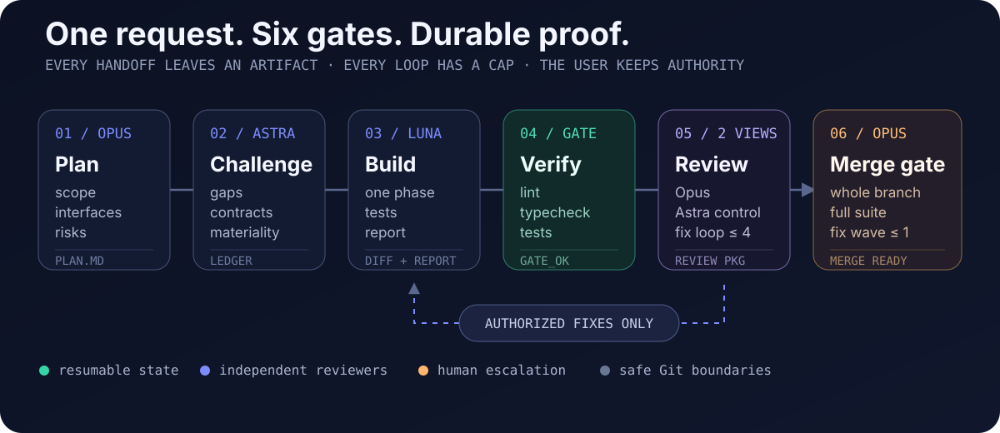

<p align="center">
  
</p>

<p align="center">
  <a href="./README.ru.md"><strong>Читать на русском</strong></a>
  ·
  <a href="#quick-start">Quick start</a>
  ·
  <a href="#delivery-protocol">Protocol</a>
  ·
  <a href="#model-roles">Models</a>
  ·
  <a href="#inside-the-plugin">Contents</a>
</p>

<p align="center">
  
  
  
</p>

`superpowers-strigov-ver` turns Claude Code into a structured software-delivery system. One model orchestrates, specialized models plan and implement, independent reviewers challenge the result, and every important handoff leaves a durable artifact.

> **The outcome:** long implementation tasks can survive context compaction, review loops stay bounded, and code does not reach “done” until phase-level and whole-branch gates are clean.

## Quick start

### 1. Install the prerequisites

You need a recent **Claude Code**, the standalone **Codex CLI**, and a one-time Codex login:

```bash
npm install -g @openai/codex
codex login
```

Optional — the default implementer, **GLM-5.3-Flash via Z.ai's ZCode**: install [ZCode](https://github.com/zai-org/ZCode) — macOS: ZCode.app into `/Applications`; Linux: see [Linux: ZCode for the GLM channel](#linux-zcode-for-the-glm-channel) below; Windows is not supported yet — then store a GLM Coding Plan API key from <https://z.ai/manage-apikey/apikey-list> once: run `zcode-dispatch api-key set` in a terminal and paste the key at the hidden prompt. The key becomes a provider of ZCode's own "Z.ai Coding Plan" template in the wrapper's private config and does not expire. There is no OAuth login: the CLI's `zcode login` keeps no refresh token and lasts about an hour (details in the `zcode-invocation` skill, "One-time setup"). Without a key, `zcode-dispatch doctor` fails and the pipeline implements on Codex Luna `max` instead — announced, never silent. Behind a local proxy, export `ZCODE_HTTP_PROXY=http://<host>:<port>` if headless runs fail with a network error (the CLI ignores `HTTP(S)_PROXY` and the macOS system proxy; the wrapper passes this variable via the allowlist). The CLI receives an allowlisted environment; explicitly pass extra names with `ZCODE_ENV_PASSTHROUGH="NAME1,NAME2"`.

#### Linux: ZCode for the GLM channel

Z.ai ships an official Linux build of ZCode (beta) on <https://zcode.z.ai> ("All Downloads": `.deb`, `.rpm` and `.AppImage` for x64 and ARM64). The `.deb` and `.rpm` packages install into `/opt/ZCode`, which is where `zcode-dispatch` looks by default. Checked with every official 3.16.2 package (CLI 0.17.0, identical in all six): `.deb` on Debian 12 (arm64 and x64), `.rpm` on Fedora 42, and the extracted `.AppImage` (arm64). In each case `doctor` is ok and a probe reaches Z.ai.

Steps for your agent (Claude Code on the Linux machine):

1. Check the prerequisites: `node --version` (major ≥ 26; the wrapper runs the CLI with the system `node`, not the app's Electron), `flock --version` (util-linux; install it if missing), `git --version`.
2. Install ZCode. Ask the user first: it needs sudo and a download of about 170 MB. Take the link for the machine's architecture (`uname -m`: `x86_64` → x64, `aarch64` → ARM64) from the "All Downloads" section of <https://zcode.z.ai>. Then:
   - Debian/Ubuntu: `sudo apt install ./ZCode-<ver>-linux-<arch>.deb`
   - Fedora/RHEL/openSUSE: `sudo dnf install ./ZCode-<ver>-linux-<arch>.rpm` (or `zypper install`)
   - No sudo: download the `.AppImage`, run `chmod +x ZCode-*.AppImage && ./ZCode-*.AppImage --appimage-extract` in a directory of your choice, and set `"env": { "ZCODE_APP": "<that dir>/squashfs-root" }` in `~/.claude/settings.json` so every `zcode-dispatch` call sees it. (Extraction needs neither FUSE nor sudo. Afterwards `squashfs-root/resources/glm/zcode.cjs` must exist.)
3. Verify. `<root>` below is `/opt/ZCode` for `.deb`/`.rpm`, or `<that dir>/squashfs-root` for the AppImage. `doctor` needs a git work tree, so run it from the repository the pipeline will work in, or pass `--cwd <repo>`:
   - `node <root>/resources/glm/zcode.cjs --version` prints the CLI version;
   - `zcode-dispatch doctor --cwd <repo>` shows `ok platform: linux (config lock: flock(1))` and `ok app: <root> <version>`.

   At this point only `personal-config` and `auth` may fail, because no key is stored yet. `WARN app-version` means the installed version differs from the version the wrapper was verified on, which is fine if the probe in step 4 passes. If the version cannot be read, `doctor` fails `app` instead.
4. Hand the API key step to the user. Never ask for the key in the chat. Give the user one exact command line for their own terminal, with the absolute path of `zcode-dispatch`. For an AppImage install, add a `ZCODE_APP=<root>` prefix, because their shell does not see Claude Code's `settings.json`:

   ```
   /path/to/bin/zcode-dispatch api-key set                                              # .deb / .rpm
   ZCODE_APP=/home/<user>/apps/squashfs-root /path/to/bin/zcode-dispatch api-key set    # AppImage
   ```

   The user runs it and pastes the key at the hidden prompt. Then run `zcode-dispatch doctor --probe --cwd <repo>` (one short request): `probe: ok` means the GLM channel is up.

Notes:
- The package also puts `/usr/bin/zcode` on `PATH`. That is the desktop app's launcher, not the CLI; the wrapper never uses it.
- Do not install third-party ZCode CLI packages (for example `zcode-app-cli` from npm).
- Behind a proxy, export `ZCODE_HTTP_PROXY` (see above).
- Without the official package (for example on an unsupported distribution), copying `resources/{glm,config,app.asar}` from a ZCode install of the same version on macOS (`/Applications/ZCode.app/Contents/Resources`) or Windows into `/opt/ZCode/resources/` also works.

### 2. Install the plugin

Run in Claude Code:

```text
/plugin marketplace add strigov/strigov-cc-plugins
/plugin install superpowers-strigov-ver@strigov-cc-plugins
/reload-plugins
```

The companion runtime is already vendored. OpenAI's separate `codex-plugin-cc` Claude Code plugin is **not** required.

### 3. Ship a real task

```text
/dev Implement resumable uploads with integrity checks
```

The pipeline never starts on its own. Start it with `/dev`, or with `/superpowers-strigov-ver:brainstorming` to settle the design first. To pick an in-progress plan back up in a new session, type `/dev` with no task or just ask to continue: a quiet SessionStart hook names the plan. Inside the pipeline, `dev-orchestrator` triages the task, and trivial single-file edits take a lightweight Sonnet quickfix path.

## What changes

| Default agent workflow | This plugin |
|---|---|
| One model plans, writes, and grades its own work | Different model families write and review each artifact |
| Progress lives mainly in chat context | Plans, ledgers, reports, diffs, and task IDs make progress resumable |
| Review can expand scope or loop indefinitely | Authorization rules, churn detection, and hard round caps bound every loop |
| A green phase can still hide integration failures | A final whole-branch review checks contracts and runs the full suite |

## Delivery protocol

<p align="center">
  
</p>

1. **Plan** — an Opus `xhigh` subagent explores the repository and writes a durable implementation plan with scope, interfaces, global constraints, tests, risks, and an explicit SECURITY/DATA_LOSS tag for every phase.
2. **Challenge** — a fresh Codex Astra `xhigh` review finds material gaps, including missing risk tags; authorized corrections go back to a fresh Opus `high` reviser through the ledger.
3. **Build** — GLM-5.3-Flash `max` implements one phase through Z.ai's own ZCode CLI and writes a report. Codex Luna `max` takes over when the GLM channel is down or switched off; Sol 6.1 `xhigh` implements phases tagged SECURITY/DATA_LOSS from the start and takes over when an Opus diagnosis, a stalled gate or a third blocked review round calls for deeper reasoning.
4. **Verify** — a Sonnet `medium` gate runs lint, typecheck, and affected tests before expensive review begins.
5. **Review twice** — Opus `high` checks spec compliance and quality (`xhigh` on SECURITY/DATA_LOSS phases and in the last round), then a fresh Codex Astra `high` control review probes edge cases, races, security, and regressions.
6. **Gate the branch** — after all phases pass, a fresh Opus `xhigh` review checks the complete branch and full test suite (Astra `xhigh` if Opus is unavailable). One consolidated fix wave is allowed before the final verdict.

Every implementer continuation is addressed by id with `--resume-task` — `task-…` for Codex threads, `zt-…` for ZCode sessions. Reviewers receive a generated package containing the commit list, stat, and contextual diff instead of reconstructing the change from chat history.

## Model roles

Every role runs on a pinned model + effort pair. Claude subagents receive an explicit `effort` on the Agent call (no `ultrathink`); Codex tasks receive explicit `--model` + `--effort`.

| Role | Model · effort |
|---|---|
| Orchestrator (main thread) | Claude Sonnet · `medium` |
| Plan writer / spec writer | Claude Opus · `xhigh` |
| Plan and spec reviser | Claude Opus · `high` |
| Plan and spec reviewer | GPT-6 Astra · `xhigh` |
| Implementer, fix rounds, final fix wave | GLM-5.3-Flash · `max` via Z.ai's ZCode CLI |
| Availability fallback (GLM down or switched off) | GPT-6 Luna · `max` |
| SECURITY/DATA_LOSS phases, reasoning escalation | GPT-6.1 Sol · `xhigh` |
| Frontend implementer | Claude Opus · `high` (new UI) / Claude Sonnet · `medium` (tweaks) |
| Primary code review (4.1) | Claude Opus · `high`; `xhigh` on SECURITY/DATA_LOSS phases and in round 4 |
| Control review (4.2) | GPT-6 Astra · `high` |
| Final whole-branch review | Claude Opus · `xhigh`; GPT-6 Astra · `xhigh` if Opus is unavailable |
| BLOCKED and gate-stall diagnosis, impasse summaries | Claude Opus · `high` |
| Verification gate, synthesis, quickfix, integration check | Claude Sonnet · `medium` |

`max` is reserved for the implementers GLM and Luna (or used when the user asks for it by name); `ultra` is never chosen automatically — only when the user explicitly asks for it. GLM quota: on 2026-10-14 the 1.5× ZCode quota bonus measured inconclusive (expected/measured credits = 3.02 at the standard rate, or 1.51 if the window was off-peak; details in docs/zcode-cli-findings.md).

This table is the built-in scheme: with no `config.json` it is exactly what runs. Any role can be rebound to a profile of your own — see [Your own harnesses and APIs](#your-own-harnesses-and-apis).

## Your own harnesses and APIs

`bin/agent-dispatch` binds pipeline roles to **profiles**. A profile is a harness, a way to pay (the harness's own login or an API key), a model and an effort. A role takes a **chain** of profiles: the first is the primary, the others are fallbacks in order. Without a configuration file nothing changes.

This release (0.12.0) ships the routing layer: profiles, keys, `route`, `doctor`, job status, and the pass-through to ZCode and Codex. You can already move the in-session roles to another Claude model or effort, and the external roles to other Codex models. Adapters for `claude -p`, DeepSeek Harness (`dsh`), OpenCode and pi come in the next releases. Until then, a profile on one of those harnesses is refused with `harness <h> is not available in this version`, and the orchestrator moves on to the next profile in the chain.

`agent-dispatch` lives in the plugin's `bin/`. In your own terminal, call it by its absolute path; Claude can print it for you.

### A profile in three steps

```bash
agent-dispatch preset list                                          # what can be copied
agent-dispatch profile add deepseek-claude --from claude-deepseek   # 1. a profile from a preset
agent-dispatch key set deepseek                                     # 2. the key, at a hidden prompt
agent-dispatch doctor --profile deepseek-claude --probe             # 3. offline checks + one short paid request
```

1. `profile add <name> --from <preset> [--model M] [--key K] [--set k=v]` copies a preset into `config.json`. A preset with a `<…>` placeholder needs it filled by a flag; otherwise nothing is written.
2. Store the key yourself, in your own terminal. `key set <name>` asks for it at a hidden prompt. From a Claude Code session you can pipe it instead: `! pbpaste | agent-dispatch key set <name>`, or on Linux `wl-paste` / `xclip -o -selection clipboard`. A key passed as an argument is refused. A `login` profile uses the harness's own login. For a profile with its own isolated directory, run `eval "$(agent-dispatch profile env <name>)"` first.
3. `doctor --profile <name>` checks everything that can be checked without a model call. `--probe` adds one short paid request on your key or subscription; you run it, the pipeline never does.

In 0.12.0 every preset targets `claude`, `dsh`, OpenCode or pi, so step 3 of this example ends in `harness claude is not available in this version` until that harness's adapter ships. The profiles that work today are written by hand: another Codex model or effort, or another Claude model in the session. For example, a cheaper control review and a Sonnet plan writer:

```json
{
  "version": 1,
  "profiles": {
    "astra-medium": { "harness": "codex",  "model": "gpt-6-astra", "effort": "medium" },
    "sonnet-high":  { "harness": "inproc", "model": "sonnet",      "effort": "high" }
  },
  "roles": {
    "control-review": ["astra-medium"],
    "plan-writer":    ["sonnet-high"]
  }
}
```

**Where it lives.** Your profiles and roles are in `~/.claude/plugins/data/superpowers-strigov-ver-agents/config.json`. The directory has mode 0700, and the file holds no secrets: keys sit in `keys/<name>` with mode 0600.

- The file needs `"version": 1`.
- Your profiles are added to the built-in ones. The built-in profiles cannot be redefined: `glm`, `luna`, `sol`, `astra`, `astra-high`, `opus-xhigh`, `opus-high` and `sonnet-medium`. To change one, copy it under a new name.
- A role in the file, `"roles": { "<role>": ["<profile>", …] }`, replaces that role's whole built-in chain. Every other role stays built-in.
- An unknown field, or a role that names a missing profile, is refused with its name, so a typo like `efort` cannot pass silently. A broken file is reported in one `config:` line, and the orchestrator asks you one question.

**Keys from elsewhere.**

- The default, `{"key": "<name>"}`, reads the key from the store above.
- A key already exported in your shell is passed only as `{"keyEnv": "VAR"}`. Without it, the environment allowlist strips the variable.
- A password manager works through `{"keyCmd": [...]}`:
  - macOS: `["security", "find-generic-password", "-w", "-s", "deepseek"]`
  - Linux: `["secret-tool", "lookup", "service", "deepseek"]`
  - any OS: `["op", "read", "op://…"]`

A key reaches only the harness process's environment, never its argv, a settings file or the chat. The pipeline never runs `key set` and never asks you for a key.

Profiles that share a key, a harness login (an OpenCode or pi login counts per provider) or a `shares` label drop out together on `auth` or `quota`. The built-in `glm` carries `zai-coding-plan`, so a Z.ai API fallback with that label is not tried against the same exhausted quota.

### Role routing

| Role (name in `config.json`) | Where in the pipeline | Default | Runs |
|---|---|---|---|
| `plan-writer` | plan writer | `opus-xhigh` | in the session (Agent tool) |
| `plan-reviser` | plan revisions | `opus-high` | in the session |
| `plan-reviewer` | plan review (loop up to 4) | `astra` | external harness |
| `spec-reviewer` | spec review in brainstorming | `astra` | external harness |
| `implementer` | non-frontend phases, fix, gate-fix, final fix wave, integration repair | `glm`, `luna` | external harness |
| `implementer.risk` | SECURITY/DATA_LOSS phases | `sol` | external harness |
| `implementer.escalation` | escalation to deeper reasoning | `sol` | external harness |
| `frontend.new-ui` | frontend phases with new UI | `opus-high` | in the session |
| `frontend.tweak` | tweaks to existing frontend | `sonnet-medium` | in the session |
| `gate` | lint, typecheck, affected tests | `sonnet-medium` | in the session |
| `phase-review` | phase review 4.1 | `opus-high` | in the session |
| `phase-review.escalated` | phase review 4.1 on risk-marked phases and in round 4 | `opus-xhigh` | in the session |
| `control-review` | control review 4.2 | `astra-high` | external harness |
| `synthesis` | review synthesis | `sonnet-medium` | in the session |
| `final-review` | final whole-branch review | `opus-xhigh`, `astra` | in the session, then external |
| `diagnosis` | BLOCKED, stalled gate | `opus-high` | in the session |
| `quickfix` | trivial edits | `sonnet-medium` | in the session |
| `integration-check` | parallel-group integration check | `sonnet-medium` | in the session |
| `adhoc-review` | `requesting-code-review`, the second opinion in `systematic-debugging` | `astra-high` | external harness |

`frontend.new-ui` and `frontend.tweak` are two roles, not a chain: triage picks one, as before.

An example for someone without OpenAI:

```json
"roles": {
  "implementer":            ["glm", "deepseek-dsh"],
  "implementer.risk":       ["claude-sub"],
  "implementer.escalation": ["claude-sub"],
  "plan-reviewer":          ["deepseek-claude", "oc-copilot"],
  "spec-reviewer":          ["deepseek-claude"],
  "control-review":         ["deepseek-claude", "glm-api"],
  "final-review":           ["opus-xhigh", "deepseek-claude"],
  "adhoc-review":           ["deepseek-claude"]
}
```

- When GLM fails, a phase goes to `deepseek-dsh` instead of Luna.
- Risk-marked phases and escalations run on Opus through the Claude subscription.
- Reviewers run on DeepSeek, with Copilot and the GLM API as fallbacks.

More about routing:

- **In-session roles.** These roles can be bound to your own `inproc` profiles, that is, to another Claude model or effort. For example, on Claude Pro you can define `"sonnet-high": { "harness": "inproc", "model": "sonnet", "effort": "high" }` and set `"plan-writer": ["sonnet-high"]`. Running these roles on external harnesses comes in a later release. Until then, `route` uses only the in-session profiles of such a chain (with none left, the built-in one) and prints one note. `final-review` also starts in the session: its in-session profiles always come first (with none configured, `opus-xhigh`), and your external profiles run only after them, as fallbacks, whatever order you write. So `"final-review": ["astra"]` still starts on `opus-xhigh`, and `route --all` prints `routes: default` plus a note, because it compares the chains that will actually run.
- **How the pipeline reads routes.**
  - At start and after a compaction, the orchestrator runs `agent-dispatch route --all`. The answer `routes: default` is not announced. Otherwise you get one line with your differences.
  - Before every reviewer dispatch, at a phase's first implementer dispatch and at every switch it runs `route <role>`, so nothing has to be remembered. A phase's retries and fix rounds stay on its current profile.
  - After `routes: default` these calls are skipped and the built-in scheme answers.
  - A switch to the next profile in a chain is one announced line, for example `Channel implementer: glm-api → deepseek-dsh (glm-api: quota).` Switches between built-in profiles keep their old lines, such as `GLM channel failed … falls back to Luna max`.
- **Kill switch.**
  - "без GLM" and "через Luna" work as before.
  - With your own routing (`route --all` does not print `routes: default`), "без <profile>" drops any profile from every chain until the session ends; with the built-in scheme only "без GLM" and "через Luna" work, as before. With the example above, "без GLM" sends every phase, risk-marked ones included, to `deepseek-dsh`.
  - `SP_IMPLEMENTER=luna` works as before. `SP_IMPLEMENTER=<profile>`, where the profile is one you defined in `config.json` and it runs outside the session, makes that profile the implementer for every non-frontend phase and turns GLM off; when it fails, the pipeline asks you instead of moving on. `SP_IMPLEMENTER=glm` names the default and changes nothing. Any other value is ignored, as before: a built-in name such as `sol` (to make Sol the implementer, write `"implementer": ["sol"]` in `config.json`), an unknown name, an in-session profile. GLM stays on. Without profiles of your own nothing is announced; with them you get one line of notice at start.
- **Family rule.** In the built-in scheme the writer and the reviewer of an artifact come from different model families. `agent-dispatch` does not check your routing for this. Keep each reviewer in a different family from the plan writer and the implementer.

### What providers allow — for reference, as of 2026-10-20; your responsibility

| Subscription / key | Officially allowed | Grey zone | Not allowed |
|---|---|---|---|
| Claude Pro/Max | Claude Code, including `claude -p` [AN1, AN4] | — | OAuth in third-party harnesses (OpenCode, pi and others) |
| ChatGPT Plus/Pro | Codex; OpenCode, pi ("Sign in with ChatGPT"), Kilo [OA1, OA6] | harnesses OpenAI does not name | ChatGPT Business/Enterprise in third-party harnesses |
| GLM Coding Plan | ZCode, Claude Code, Codex, OpenCode, pi, Crush, Kilo, Cline | — | tools missing from Z.ai's list (Qwen Code, Kimi CLI, dsh) |
| GitHub Copilot | OpenCode [GH1] | Crush, Kilo, Cline | pi's login (pi presents itself as VS Code) |
| OpenCode Go | Claude Code, Codex, ZCode, pi, OpenCode, Kilo | — | — |
| OpenCode Zen | OpenCode | outside OpenCode | — |
| Kimi Code | interactive use | headless runs (Kimi's terms say interactive only, although the CLI docs show `kimi -p`) | — |
| MiniMax M Plan | any compatible tool | headless runs (the plan is meant for interactive use) | — |
| Alibaba Coding Plan | interactive use | — | headless runs [AL1] |
| Alibaba / QwenCloud Token Plan | — | headless runs | — |
| Google AI (Gemini, Antigravity) | Google's tools | — | OAuth in third-party harnesses; running `agy` from a third-party harness |
| Ollama Cloud | — | automation (not explicitly allowed by the terms) | — |
| Any pay-as-you-go key (DeepSeek, Z.ai Standard, Kimi Platform, MiniMax API, Alibaba PAYG, OpenRouter) | any harness | — | — |
| Local model | any harness | — | — |

`claude -p` with a third-party endpoint does not breach Anthropic's terms, but Anthropic does not support that configuration.

The source IDs in brackets refer to [docs/research/universal-dispatchers/07-tos-matrix.md](./docs/research/universal-dispatchers/07-tos-matrix.md).

### If something breaks

Collect three things and attach them to an issue or a message to the owner:

- the output of `agent-dispatch doctor --profile <p>`;
- the output of `agent-dispatch status <id> --json`;
- the job log, `state/<workspace>/jobs/<id>.log` in the data directory above. Secrets are redacted in it.

If an endpoint rejects the request's beta fields, add `CLAUDE_CODE_DISABLE_EXPERIMENTAL_BETAS=1` to the profile's `env`.

## Guardrails

- **Manual start** — pipeline skills carry `disable-model-invocation: true`: the model neither sees nor loads them on its own. They run only after you start them, chain into each other by reading `SKILL.md` files, and resume an in-progress plan only when you ask to continue. The discipline skills (`systematic-debugging`, `test-driven-development`, `verification-before-completion`, `receiving-code-review`) still trigger automatically.
- **Independent judgment** — the writer and reviewer of an artifact come from different model families.
- **Authorization ledger** — review feedback is triaged before a fixer receives it; scope expansion is never silently implemented.
- **Bounded loops** — plan and phase reviews cap at four rounds; final whole-branch review caps at two.
- **No review ping-pong** — rejected findings cannot return unchanged, identical blocker lists escalate, and late low-materiality churn cannot keep a converged loop alive.
- **Human authority** — plan conflicts, material scope changes, and unresolved impasses return to the user.
- **Safe Git** — no `--no-verify`, no amend, no force push, and no push without explicit approval in the current session.
- **Isolated parallelism** — plan-marked independent phases may run in separate worktrees, with a hard concurrency width of two.
- **Terms-respecting GLM access** — GLM is reached only through Z.ai's own ZCode CLI with truthful client identification; no raw API, no token extraction; GLM never receives SECURITY / DATA_LOSS phases and runs unsandboxed only inside a git tree under the preamble's restrictions.

## Inside the plugin

### Fork-specific capabilities

| Component | Purpose |
|---|---|
| `dev-orchestrator` | Complete planning, implementation, verification, review, commit, and resume protocol |
| `codex-invocation` | Reliable background Codex dispatch through the vendored companion runtime |
| `zcode-invocation` | Background GLM-5.3-Flash dispatch through Z.ai's ZCode CLI: setup, doctor/probe, Monitor loop, failure handling |
| `agent-invocation` | Role routing through `agent-dispatch` profiles: `route`, jobs by id prefix, failure classes, headless preambles |
| `architecture-memory` | Compact persistent architecture map in `docs/ARCHI.md` |
| `/dev` | Explicit entry point for the full delivery protocol; with no task, resumes an in-progress plan |
| `bin/pipeline-context` | SessionStart hook: names an in-progress plan and the skill to re-read after compaction, otherwise silent |
| `bin/review-package` | Generates reviewer-ready commit and diff packages |
| `bin/sdd-workspace` | Resolves isolated per-plan scratch workspaces |
| `bin/zcode-dispatch` | ZCode CLI job wrapper: task/status/result/cancel/release-stale/doctor/api-key with pinned model, mode and client identification; `release-stale` frees a workspace reservation left by a crashed job, after verifying it is dead |
| `bin/agent-dispatch` | Profiles, keys and role routes (`route`, `channels`, `doctor`); one `status` across ZCode, Codex and its own jobs; pass-through to `zcode-dispatch` and `codex-dispatch` |

### Adapted Superpowers skills

`brainstorming`, `dispatching-parallel-agents`, `executing-plans`, `finishing-a-development-branch`, `receiving-code-review`, `requesting-code-review`, `systematic-debugging`, `test-driven-development`, `using-git-worktrees`, `verification-before-completion`, `writing-plans`, and `writing-skills`.

The upstream `subagent-driven-development` skill is replaced by `dev-orchestrator`. The aggressive `using-superpowers` injection and its SessionStart hook are intentionally not included; the plugin's own SessionStart hook speaks only when a plan is in progress or a pipeline skill needs re-reading after compaction.

<details>
<summary><strong>Repository map</strong></summary>

```text
.
├── .claude-plugin/plugin.json       # Plugin manifest and source version
├── commands/dev.md                  # /dev command entry point
├── hooks/hooks.json                 # SessionStart → bin/pipeline-context
├── bin/
│   ├── agent-dispatch               # Profiles, keys, role routes, job dispatch
│   ├── codex-dispatch               # Vendored companion wrapper
│   ├── pipeline-context             # In-progress plan / re-read hint for the session
│   ├── review-package               # Reviewer-ready diff package generator
│   ├── sdd-workspace                # Per-plan scratch workspace resolver
│   ├── zcode-dispatch               # ZCode CLI job wrapper (shim)
│   ├── lib/zcode-dispatch.mjs       # ZCode job runner, records, doctor
│   ├── lib/agent-core.mjs           # Shared job core for agent-dispatch
│   ├── lib/agent-dispatch.mjs       # agent-dispatch CLI, config, routes
│   ├── lib/agents-defaults.json     # Built-in profiles, roles, presets
│   └── lib/adapters/                # Harness adapters
├── skills/
│   ├── dev-orchestrator/            # Protocol and role prompt templates
│   ├── agent-invocation/
│   ├── codex-invocation/
│   ├── zcode-invocation/
│   ├── architecture-memory/
│   └── ...                          # Adapted Superpowers skills
├── tests/test-sdd-scripts.sh        # Workspace/package integration tests
├── tests/test-pipeline-context.sh   # SessionStart hook + manual-only skill checks
├── tests/test-zcode-dispatch.sh     # ZCode wrapper tests (stubbed CLI)
├── tests/test-agent-core.sh         # Job core tests (trivial adapter)
├── tests/test-agent-dispatch.sh     # agent-dispatch tests (stubbed wrappers)
├── tests/test-orchestrator-defaults.sh  # Built-in roles, commands and caps unchanged
└── vendor/codex-companion/          # Vendored OpenAI companion runtime
```

</details>

<details>
<summary><strong>Vendored Codex companion</strong></summary>

All Codex calls go through `bin/codex-dispatch`. The wrapper works from a marketplace installation or local checkout and isolates state under `~/.claude/plugins/data/superpowers-strigov-ver-codex`.

The upstream base is recorded in `vendor/codex-companion/VERSION`. Local patches add thread-addressed resume, GPT-6 `max`/`ultra` reasoning efforts, broker cleanup, and optional review-authorization fields.

</details>

## Development and releases

Run the test suites:

```bash
bash tests/test-sdd-scripts.sh
bash tests/test-pipeline-context.sh
bash tests/test-zcode-dispatch.sh
bash tests/test-agent-core.sh
bash tests/test-agent-dispatch.sh
bash tests/test-orchestrator-defaults.sh
```

For a release, synchronize the version in `.claude-plugin/plugin.json`, both README files, `PLUGIN_README.md`, and the plugin entry in the external [`strigov-cc-plugins` marketplace catalog](https://github.com/strigov/strigov-cc-plugins). Updating this repository alone does not publish a marketplace release.

## Provenance

- [Superpowers](https://github.com/obra/superpowers) by Jesse Vincent / obra — MIT. This fork includes adapted v5.0.7 skills and selected source-verified mechanisms from Superpowers 6 v6.1.1.
- [TRIP-workflow](https://github.com/PiLastDigit/TRIP-workflow) by PiLastDigit — MIT. Thread-addressed resume, verification gates, review synthesis, the ad-hoc consultation template, and architecture-memory concepts were adapted from this project.
- The vendored Codex companion originates from OpenAI's `codex-plugin-cc` and retains its Apache-2.0 license.

## License

Original work in this repository is released under the [MIT License](./LICENSE). Vendored components retain their respective licenses.
