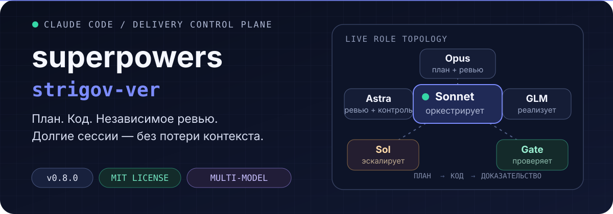
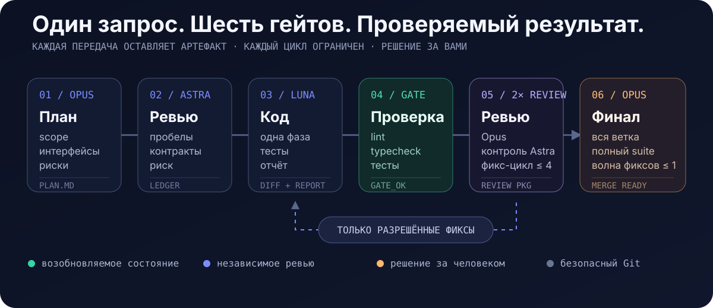

<p align="center">
  
</p>

<p align="center">
  <a href="./README.md"><strong>Read in English</strong></a>
  ·
  <a href="#быстрый-старт">Быстрый старт</a>
  ·
  <a href="#протокол-разработки">Протокол</a>
  ·
  <a href="#роли-моделей">Модели</a>
  ·
  <a href="#что-входит-в-плагин">Состав</a>
</p>

<p align="center">
  
  
  
</p>

`superpowers-strigov-ver` превращает Claude Code в структурированную систему разработки. Одна модель оркестрирует процесс, специализированные модели планируют и пишут код, независимые ревьюеры проверяют результат, а каждая важная передача оставляет долговечный артефакт.

> **Результат:** длинные задачи переживают compaction контекста, циклы ревью остаются ограниченными, а код не считается готовым, пока не пройдены гейты фазы и всей ветки.

## Быстрый старт

### 1. Установите зависимости

Нужны актуальный **Claude Code**, отдельный **Codex CLI** и однократный вход в Codex:

```bash
npm install -g @openai/codex
codex login
```

Необязательно — имплементер по умолчанию, **GLM-5.3-Flash через ZCode от Z.ai**: установите [ZCode.app](https://github.com/zai-org/ZCode) в `/Applications` и один раз войдите в его CLI под аккаунтом GLM Coding Plan через `zcode-dispatch login` — команда запускает собственный `zcode login zai` от ZCode в отдельном каталоге данных CLI, принадлежащем обёртке, поэтому вход в десктопном приложении ZCode не затрагивается; повторите вход, когда логин CLI истечёт (подробности — в скилле `zcode-invocation`, раздел «One-time setup»). Без этого `zcode-dispatch doctor` не проходит, и пайплайн реализует фазы на Codex Luna `max` — с объявлением, никогда молча. За локальным прокси добавьте перед командой входа `ZCODE_HTTP_PROXY=http://<host>:<port>` (CLI игнорирует `HTTP(S)_PROXY` и системный прокси macOS; обёртка передаёт эту переменную и в фоновые запуски).

### 2. Установите плагин

Выполните в Claude Code:

```text
/plugin marketplace add strigov/strigov-cc-plugins
/plugin install superpowers-strigov-ver@strigov-cc-plugins
/reload-plugins
```

Companion runtime уже вендорится. Отдельный Claude Code-плагин OpenAI `codex-plugin-cc` **не нужен**.

### 3. Запустите реальную задачу

```text
/dev Реализуй возобновляемую загрузку файлов с проверкой целостности
```

Можно и просто описать задачу обычным текстом. Плагин распознаёт английские и русские запросы и сам выполняет триаж. Тривиальные правки одного файла идут по облегчённому пути Sonnet quickfix.

## Что меняется

| Обычный агентный процесс | Этот плагин |
|---|---|
| Одна модель планирует, пишет и сама оценивает свою работу | Каждый артефакт пишут и ревьюят разные модельные семейства |
| Прогресс живёт в основном в контексте чата | Планы, ledger, отчёты, diff и task ID позволяют возобновлять работу |
| Ревью может расширять scope или циклиться | Правила авторизации, детекторы churn и жёсткие лимиты ограничивают каждый цикл |
| Зелёная фаза может скрывать интеграционные ошибки | Финальное ревью всей ветки проверяет контракты и запускает полный suite |

## Протокол разработки

<p align="center">
  
</p>

1. **План** — Opus-субагент на `xhigh` исследует репозиторий и пишет долговечный план со scope, интерфейсами, глобальными ограничениями, тестами и рисками.
2. **Критика** — свежее ревью Codex Astra `xhigh` ищет материальные пробелы; разрешённые правки уходят свежему Opus `high` через ledger.
3. **Реализация** — GLM-5.3-Flash `max` реализует одну фазу через собственный ZCode CLI от Z.ai и пишет отчёт. Codex Luna `max` подхватывает работу, если канал GLM недоступен или выключен; Sol 6.1 `xhigh` с самого начала реализует фазы SECURITY/DATA_LOSS и подхватывает работу, когда диагностика Opus, застрявший гейт или третий заблокированный раунд ревью требуют более глубокого reasoning.
4. **Верификация** — Sonnet-гейт на `medium` запускает lint, typecheck и затронутые тесты до начала дорогого ревью.
5. **Два ревью** — Opus `high` проверяет соответствие плану и качество (`xhigh` на фазах SECURITY/DATA_LOSS и в последнем раунде), затем свежий Codex Astra `high` ищет граничные случаи, гонки, уязвимости и регрессии.
6. **Гейт ветки** — после всех фаз свежий Opus `xhigh` проверяет всю ветку и полный набор тестов (Astra `xhigh`, если Opus недоступен). До финального вердикта разрешена одна объединённая волна фиксов.

Каждое продолжение имплементера адресуется по id через `--resume-task` — `task-…` для тредов Codex, `zt-…` для сессий ZCode. Ревьюеры получают сгенерированный пакет со списком коммитов, статистикой и контекстным diff, а не восстанавливают изменения из истории чата.

## Роли моделей

У каждой роли закреплена пара «модель + effort». Claude-субагенты получают явный `effort` в вызове Agent (без `ultrathink`); задачи Codex — явные `--model` и `--effort`.

| Роль | Модель · effort |
|---|---|
| Оркестратор (главный тред) | Claude Sonnet · `medium` |
| Автор плана / спеки | Claude Opus · `xhigh` |
| Ревизия плана и спеки | Claude Opus · `high` |
| Ревьюер плана и спеки | GPT-6 Astra · `xhigh` |
| Имплементер, fix-раунды, финальная волна фиксов | GLM-5.3-Flash · `max` через ZCode CLI от Z.ai |
| Резерв по доступности (GLM недоступен или выключен) | GPT-6 Luna · `max` |
| Фазы SECURITY/DATA_LOSS, эскалация reasoning | GPT-6.1 Sol · `xhigh` |
| Фронтенд-имплементер | Claude Opus · `high` (новый UI) / Claude Sonnet · `medium` (мелкие правки) |
| Основное ревью кода (4.1) | Claude Opus · `high`; `xhigh` на фазах SECURITY/DATA_LOSS и в раунде 4 |
| Контрольное ревью (4.2) | GPT-6 Astra · `high` |
| Финальное ревью ветки | Claude Opus · `xhigh`; GPT-6 Astra · `xhigh`, если Opus недоступен |
| Диагностика BLOCKED и застрявшего гейта, сводка по тупику (impasse) | Claude Opus · `high` |
| Гейт верификации, синтез, quickfix, integration check | Claude Sonnet · `medium` |

`max` зарезервирован за имплементерами GLM и Luna (или по явному запросу пользователя); `ultra` никогда не выбирается автоматически — только по явному запросу пользователя. Квота GLM: 2026-10-14 бонус 1.5× для ZCode по замеру не определён (ожидаемые/списанные кредиты = 3.02 по стандартному тарифу или 1.51, если окно пришлось на непиковые часы; подробности в docs/zcode-cli-findings.md).

## Защитные механизмы

- **Независимое суждение** — автор и ревьюер артефакта принадлежат разным модельным семействам.
- **Authorization ledger** — замечания проходят триаж до передачи фиксеру; расширение scope не реализуется молча.
- **Ограниченные циклы** — ревью плана и фазы ограничено четырьмя раундами, финальное ревью ветки — двумя.
- **Без review ping-pong** — отклонённые замечания не возвращаются без нового основания, одинаковые списки блокеров эскалируются, а поздний малозначимый churn не может бесконечно удерживать цикл.
- **Власть человека** — конфликты с планом, материальное расширение scope и неразрешимые тупики возвращаются пользователю.
- **Безопасный Git** — без `--no-verify`, amend, force push и push без явного согласия в текущей сессии.
- **Изолированный параллелизм** — независимые фазы из плана могут идти в отдельных worktree с жёстким лимитом параллелизма два.
- **Доступ к GLM по правилам Z.ai** — GLM вызывается только через собственный ZCode CLI от Z.ai с честной идентификацией клиента; без прямого API и извлечения токенов; GLM никогда не получает фазы SECURITY / DATA_LOSS и работает без песочницы только внутри git-дерева под ограничениями преамбулы.

## Что входит в плагин

### Собственные возможности форка

| Компонент | Назначение |
|---|---|
| `dev-orchestrator` | Полный протокол планирования, реализации, верификации, ревью, коммитов и возобновления |
| `codex-invocation` | Надёжный фоновый dispatch Codex через вендорный companion runtime |
| `zcode-invocation` | Фоновый dispatch GLM-5.3-Flash через ZCode CLI от Z.ai: настройка, doctor/probe, цикл Monitor, обработка сбоев |
| `architecture-memory` | Компактная персистентная карта архитектуры в `docs/ARCHI.md` |
| `/dev` | Явная точка входа в полный протокол |
| `bin/review-package` | Генерирует готовые для ревьюера пакеты коммитов и diff |
| `bin/sdd-workspace` | Резолвит изолированные scratch-workspace для каждого плана |
| `bin/zcode-dispatch` | Обёртка задач ZCode CLI: task/status/result/cancel/release-stale/doctor/login с закреплёнными моделью, режимом и идентификацией клиента; `release-stale` освобождает резервацию рабочего дерева, оставленную упавшей задачей, после проверки, что та мертва |

### Адаптированные скиллы Superpowers

`brainstorming`, `dispatching-parallel-agents`, `executing-plans`, `finishing-a-development-branch`, `receiving-code-review`, `requesting-code-review`, `systematic-debugging`, `test-driven-development`, `using-git-worktrees`, `verification-before-completion`, `writing-plans` и `writing-skills`.

Upstream-скилл `subagent-driven-development` заменён на `dev-orchestrator`. Агрессивная инъекция `using-superpowers` и SessionStart hook намеренно не включены.

<details>
<summary><strong>Карта репозитория</strong></summary>

```text
.
├── .claude-plugin/plugin.json       # Манифест и версия исходников
├── commands/dev.md                  # Точка входа команды /dev
├── bin/
│   ├── codex-dispatch               # Обёртка вендорного companion
│   ├── review-package               # Генератор diff-пакета для ревьюеров
│   ├── sdd-workspace                # Резолвер scratch-workspace для плана
│   ├── zcode-dispatch               # Обёртка задач ZCode CLI (shim)
│   └── lib/zcode-dispatch.mjs       # Раннер задач ZCode, записи, doctor
├── skills/
│   ├── dev-orchestrator/            # Протокол и шаблоны промптов ролей
│   ├── codex-invocation/
│   ├── zcode-invocation/
│   ├── architecture-memory/
│   └── ...                          # Адаптированные скиллы Superpowers
├── tests/test-sdd-scripts.sh        # Интеграционные тесты workspace/package
├── tests/test-zcode-dispatch.sh     # Тесты обёртки ZCode (CLI-заглушка)
└── vendor/codex-companion/          # Вендорный companion runtime OpenAI
```

</details>

<details>
<summary><strong>Вендорный Codex companion</strong></summary>

Все вызовы Codex идут через `bin/codex-dispatch`. Обёртка работает из marketplace-установки или локального checkout и изолирует состояние в `~/.claude/plugins/data/superpowers-strigov-ver-codex`.

Upstream-база записана в `vendor/codex-companion/VERSION`. Локальные патчи добавляют адресный resume, reasoning-efforts `max`/`ultra` для GPT-6, очистку broker-процессов и необязательные поля авторизации ревью.

</details>

## Разработка и выпуски

Запуск тестовых suite:

```bash
bash tests/test-sdd-scripts.sh
bash tests/test-zcode-dispatch.sh
```

Для выпуска синхронизируйте версию в `.claude-plugin/plugin.json`, обоих README, `PLUGIN_README.md` и записи плагина во внешнем [каталоге marketplace `strigov-cc-plugins`](https://github.com/strigov/strigov-cc-plugins). Обновление только этого репозитория не публикует новую marketplace-версию.

## Происхождение

- [Superpowers](https://github.com/obra/superpowers) от Jesse Vincent / obra — MIT. Форк включает адаптированные скиллы v5.0.7 и отдельные, проверенные по исходникам механизмы Superpowers 6 v6.1.1.
- [TRIP-workflow](https://github.com/PiLastDigit/TRIP-workflow) от PiLastDigit — MIT. Отсюда адаптированы адресный resume, verification gate, синтез ревью, шаблон разовой консультации и концепция architecture memory.
- Вендорный Codex companion происходит из `codex-plugin-cc` OpenAI и сохраняет лицензию Apache-2.0.

## Лицензия

Оригинальная часть репозитория опубликована по [лицензии MIT](./LICENSE). Вендорные компоненты сохраняют свои лицензии.
